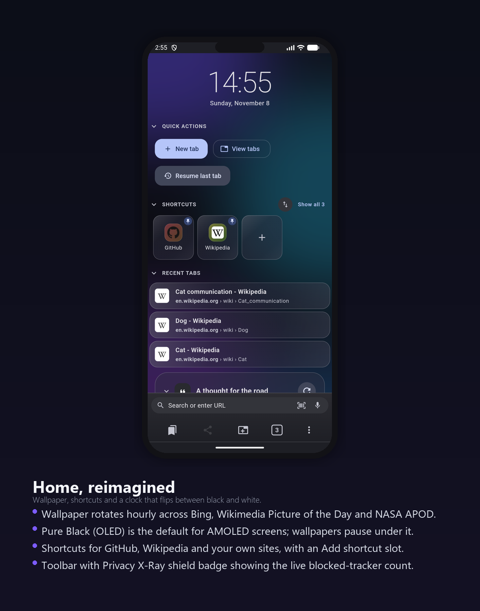
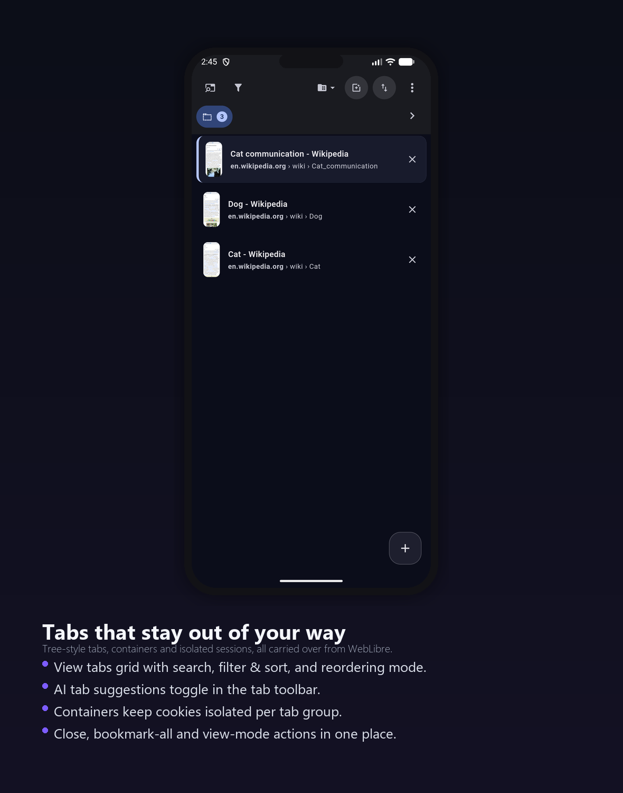
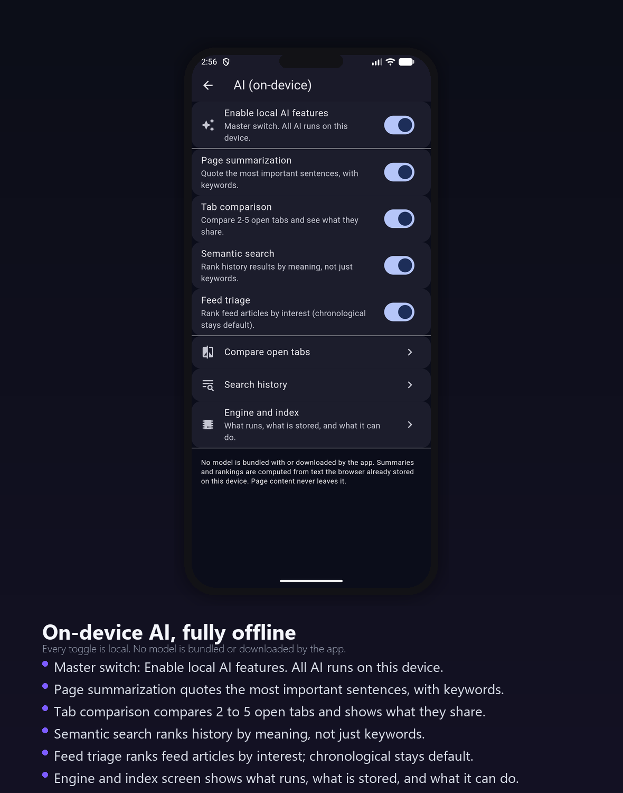
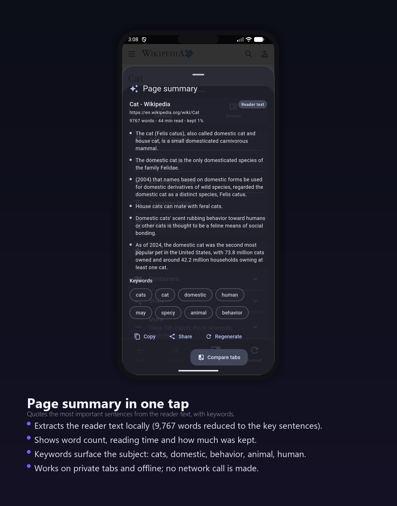
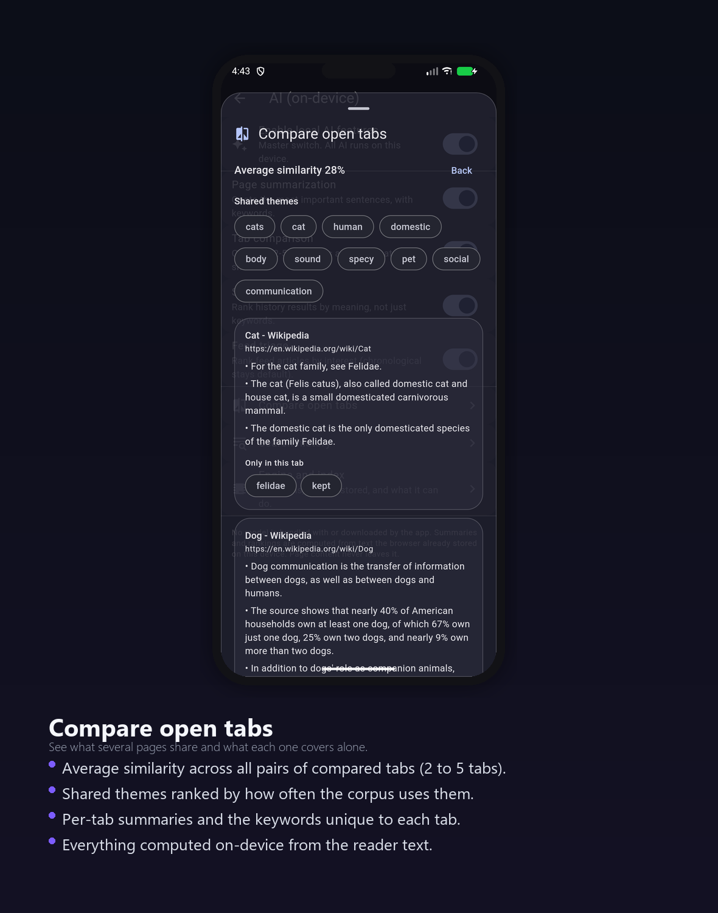

<div align="center">


<a href="https://github.com/apauruseya-stack/cat-browser">
  
</a>

<br/>


**An Android browser on Mozilla GeckoView, forked from WebLibre and pointed wherever I feel like.**
<br/>
Privacy first, real on-device AI second, and a home screen that does not look like a billboard.

[**Quick start**](#-quick-start) · [**Features**](#-what-cat-browser-adds) · [**On-device AI**](#-on-device-ai) · [**Screenshots**](#-screenshots) · [**Build**](#-build-it-yourself) · [**Credits**](#-credits-and-license)

</div>

<br/>

> [!NOTE]
> **Status:** personal fork, shared as-is. Some ideas are half-finished and a few will be reverted next month. That is the point of the fork. Read the roadmap before depending on anything.

---

## ✨ The 10-second pitch

| | |
|---|---|
| 🐱 **Cat Browser** | A fork of WebLibre with its own branding, defaults and a growing set of opinionated changes. |
| 🦊 **Real GeckoView** | Mozilla's engine, not a WebView. Full site compatibility, extensions, containers, sync. |
| 🧠 **On-device AI** | Summaries, tab comparison and semantic search computed locally. No model ships with the app, no network call is made. |
| 🛡️ **Private by default** | No telemetry, no crash reporting, no analytics. DNS over HTTPS on, trackers blocked, saner defaults. |
| 🎨 **Home, reimagined** | Wallpaper behind a clock, shortcuts, and a toolbar with a live Privacy X-Ray badge. |
| ♻️ **Fork, not a fork of a fork** | One upstream, one set of changes, one release pipeline. Easy to diff against WebLibre. |

---

## 🐾 What Cat Browser adds

| Feature | What it does | Status |
|---|---|:---:|
| **Home page redesign** | A clock instead of the brand mark, wallpaper behind it, and an hourly rotation across Bing, Wikimedia Picture of the Day and NASA APOD. Pure black is the default for AMOLED screens, and tapping the clock flips the logo between black and white. | Shipped |
| **Privacy X-Ray** | A shield badge with the live blocked count, in the toolbar and in the site info sheet, broken down by tracker category. Assigned to a toolbar button you can customize or remove. | Shipped |
| **Cookie banner handling** | Detects consent banners in every frame, including open shadow roots. Rejects through the CMP's own API first, then a reject-only click list. Never clicks "accept". Per-site modes, undo, a rule editor, and optional rule updates pinned to a hash. | Shipped, experimental |
| **Import from other browsers** | Chrome, Brave, Edge and Firefox bookmarks plus history, with a preview before anything is written, duplicate detection, cancellation and undo. | Shipped, passwords not yet |
| **Accessibility pass** | App text scale up to 200%, a capped mode so system scaling cannot multiply past the ceiling, bold text, and a reduce motion switch. | Partial |
| **Protection report** | A local dashboard showing what the browser actually blocked, computed from engine counters. No network, no telemetry. | v1 |
| **Saner defaults** | DNS over HTTPS on (Cloudflare and NextDNS), tab stacking off, Privacy Badger as an opt-in, supporter banner removed. | Shipped |
| **Fullscreen** | Immersive sticky mode, re-applied when the window metrics change, plus an optional hidden status bar. | Shipped |
| **Branding** | Cat logo, launcher icon, bundled font, and rebranded English strings. | Shipped |
| **Real CI** | A GitHub Actions pipeline that builds per-ABI APKs and an app bundle, checks the localization template, and publishes the release. | Shipped |
| **On-device AI** | Summaries, tab comparison and semantic search, all computed locally from the reader text. Model management (downloadable models) is in progress. | Shipped (extractive) |

---

## 🧠 On-device AI

The AI features are the headline of this fork. They run entirely on the device, from text the reader already extracted. There is no model to download, no API key, and no network call: summaries, tab comparison and semantic search all work in private tabs and offline.

Toggle everything from **Settings → AI (on-device)**:

| Feature | What it does |
|---|---|
| **Page summarization** | Quotes the most important sentences from the reader text, with keywords. |
| **Tab comparison** | Compares 2 to 5 open tabs and shows what they share and what each covers alone. |
| **Semantic search** | Ranks history results by meaning, not just keywords. |
| **Feed triage** | Ranks feed articles by interest; chronological order stays the default. |

A few things worth knowing:

- **Nothing ships with the app.** No model is bundled or downloaded. The whole pipeline is deterministic Dart over the text the reader already extracted, so results are reproducible.
- **The Engine and index screen** shows what runs, what is stored, and what it can do.
- **The master switch** turns all of it off at once. When it is off, none of the AI code paths run.

---

## 🧱 Inherited from WebLibre

Containers with per-container cookie isolation, isolated tabs that keep their session across restarts, tree-style tabs with pinning and stacking, Firefox-compatible extensions (uBlock Origin is offered during onboarding), local search across tabs and bookmarks and history and feeds, reader mode, translation, RSS, Firefox Sync, adaptive layout, keyboard shortcuts, gestures, and the download manager.

Two things are inherited but **not available in this build**: Tor and the proxy client. The settings category is hidden and the transport is not wired up. Do not install this expecting a VPN.

---

## 📸 Screenshots

<div align="center">

### Home, reimagined
<a href="docs/images/home.png"></a>
<br/>
<sub>Wallpaper, shortcuts, a clock that flips between black and white, and a toolbar with the Privacy X-Ray badge.</sub>

<br/><br/>

### Tabs
<a href="docs/images/tabs.png"></a>
<br/>
<sub>Tree-style tabs, containers and isolated sessions, with search, filter, sort and reordering.</sub>

<br/><br/>

### On-device AI settings
<a href="docs/images/ai-settings.png"></a>
<br/>
<sub>Every toggle is local. No model is bundled or downloaded by the app.</sub>

<br/><br/>

### Page summary
<a href="docs/images/page-summary.png"></a>
<br/>
<sub>Quotes the most important sentences, with keywords, reading time and how much was kept.</sub>

<br/><br/>

### Compare open tabs
<a href="docs/images/tab-compare.png"></a>
<br/>
<sub>Average similarity, shared themes, per-tab summaries and the keywords unique to each tab.</sub>

</div>

---

## 🔒 Privacy

There is no telemetry, no crash reporting, and no analytics in the app. Nothing about your browsing leaves the device unless you ask it to, for example by enabling online wallpapers, turning on Firefox Sync, or letting the cookie banner rules check for updates.

---

## 🚀 Quick start

### 📋 Requirements

Flutter 3.47.8, JDK 17, the Android SDK with the NDK version pinned in `apps/weblibre/android/gradle.properties`, Go 1.25 for the native runtime, Python 3 for the asset and localization scripts, and Node 20 for the JS components.

### 🛠️ Build

```bash
git clone https://github.com/apauruseya-stack/cat-browser.git
cd cat-browser
dart pub global activate melos 7.8.1
melos bootstrap
melos run build              # merges l10n fragments, then runs build_runner
melos run update-assets
melos run build-components
```

The proxy plugins need a native AAR before Gradle will configure:

```bash
melos run build-go-runtime
```

That script expects Linux or macOS, and CI runs it on Ubuntu. On Windows, build inside WSL or let GitHub Actions do it.

Then build the app:

```bash
cd apps/weblibre
flutter build apk --release --flavor stable --split-per-abi --no-tree-shake-icons
```

Flavors are `stable`, `stableImpeller`, `alpha` and `alphaImpeller`. A debug build is just `flutter run` from `apps/weblibre`.

---

## 🗂️ Project layout

| Path | What lives there |
|---|---|
| `apps/weblibre/` | The Flutter app |
| `packages/` | Shared Flutter packages, including the GeckoView bridge |
| `native/` | Go and native helpers for the proxy runtime |
| `scripts/` | Asset, localization and upstream sync scripts |
| `ROADMAP.md` | The plan, with status per milestone |
| `docs/images/` | Composed app images used in this README |

---

## 🙏 Credits and license

Cat Browser is a fork of [WebLibre](https://github.com/FaFre/WebLibre), which is itself built on Mozilla's GeckoView and Android Components. None of that work is mine, and the fork would not exist without it. WebLibre deserves the credit for almost everything under the hood.

The code is [AGPL-3.0](COPYING), same as upstream. If you redistribute it, keep the attribution and publish your changes.

Cat Browser is not affiliated with the WebLibre project or with Mozilla.

<br/>

<div align="center">

**Found it useful? Drop a ⭐ and share it.**


</div>
